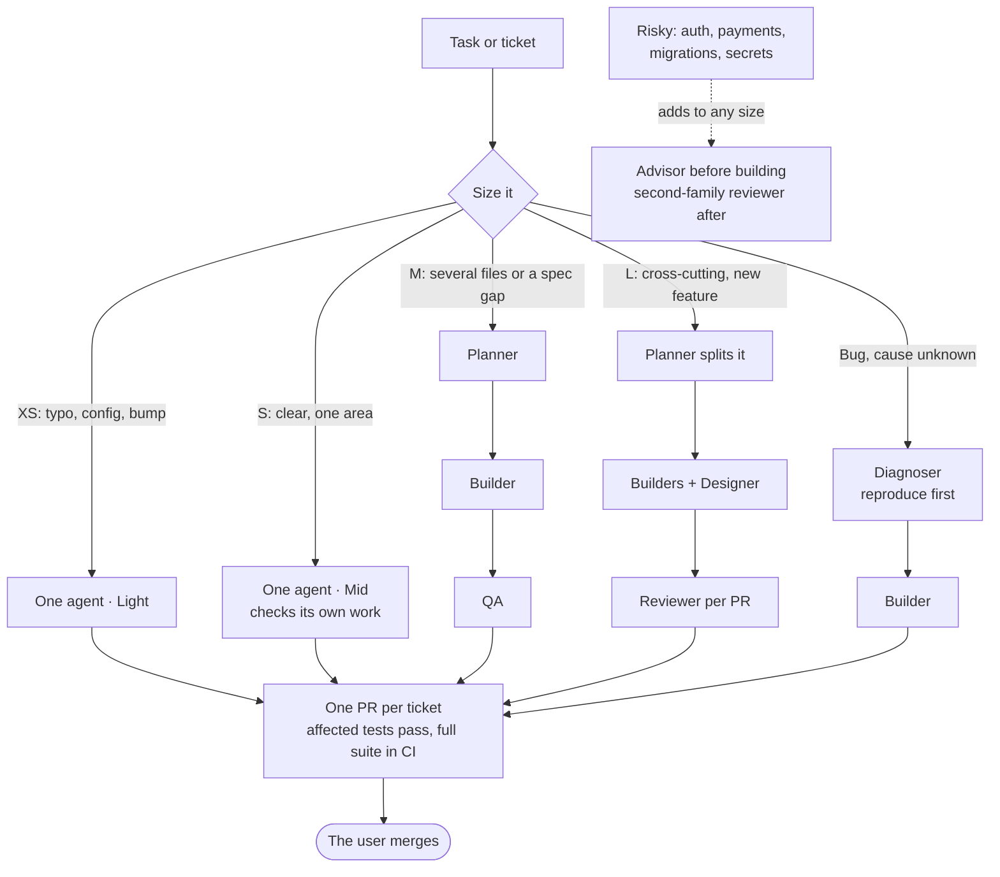
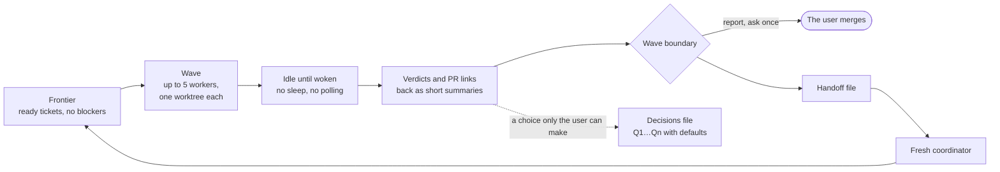

# skills

Our set of skills for doing agentic work well: getting real results from coding agents
while staying flexible about the ADE (agentic development environment, such as
[Orca](https://github.com/stablyai/orca) or [T3 Code](https://github.com/pingdotgg/t3code)),
spending tokens carefully, and mixing providers (Claude and Codex) in the same run.

**Just want it running?** Jump to [Install](#install).

## Contents

- [Principles](#principles): the four ideas behind the skills
- [How it works](#how-it-works)
  - [One task: size it, then give it a crew](#one-task-size-it-then-give-it-a-crew)
  - [A coordinator's run: waves, not polling](#a-coordinators-run-waves-not-polling)
  - [Handoff or compaction](#handoff-or-compaction)
  - [Model tiers](#model-tiers): a Claude and a Codex model per tier
  - [Roles](#roles): who to call, on which tier, and what comes back
- [Install](#install): two commands, then ask your agent to set it up
- [Skills](#skills)

## Principles

- **Proficiency.** Size each task first, then give it the right crew: one agent for small work;
  a planner, builders, QA and a reviewer for large or risky work. Every brief is
  self-contained, because a helper sees none of your history.
- **Flexible about the ADE.** The skill decides what to spawn, on which model and with what
  brief. A small host map per ADE holds the commands. Orca and T3 Code are covered, and
  another host only needs a new map.
- **Token efficiency.** Smaller models by default and step up only on evidence. The
  coordinator waits for a wake-up instead of polling, keeps diffs and logs out of its own
  context, and hands off to a fresh session when a summary would lose too much.
- **Multi-provider.** Every tier has a Claude and a Codex model in one shared
  `models.yaml`. The other family is the second opinion. Optional hooks deny any launch that
  names no model, an unlisted model, or no effort.

## How it works

### One task: size it, then give it a crew

Smaller is the default; a task steps up a size only on evidence (the same check failing
twice, or the task proving bigger).



### A coordinator's run: waves, not polling



The coordinator reads specs, not source; workers read the code.

### Handoff or compaction

At ~250k tokens (Claude) or ~190k (Codex), 25 orchestration rounds, or a phase end, an agent
chooses: hand off to a fresh session through a handoff file, or keep going and let it compact.
When unsure, it hands off: a short file and a fresh read cost less than a lossy summary.

| Hand off when any holds | Let it compact only when all hold |
|---|---|
| Coordinating, or a phase just ended | One agent, one task, a few steps from done |
| Already compacted once this session | First compaction |
| Context full of wrong turns, or a different model next | On-track context, same model finishes |
| Work must outlive the session | It ends in this session |

### Model tiers

Every helper launch names a model and an effort. Defaults live in
[`models.yaml`](skills/coordinating/models.yaml); your own picks go in
`~/.config/coordinating/models.yaml`.

| Tier | Claude | Codex | For |
|---|---|---|---|
| **Light** | Haiku · high | `gpt-6-luna` · high | XS work, log and CI summaries, sweeps, re-checks |
| **Mid** (default) | Sonnet · medium | `gpt-6.1-sol` · medium | S/M building, QA, tests, routine review |
| **Heavy** (ceiling) | Opus · high | `gpt-6.1-sol` · high | Coordinating, planning, diagnosis, L building, Risky review |

Helpers run on the coordinator's own family. The **second opinion** is the other family:
Claude coordinating → Codex reviews, and the reverse.

### Roles

Most tasks need none of these. A helper is a subagent by default, or a separate worker or
thread when it needs its own worktree, the other family, or to outlive the session.

| Role | Call it when | Tier | Hands back |
|---|---|---|---|
| **Builder** | Something needs building | By size | The PR and a short summary |
| **Planner** | M or L work, or the path isn't obvious (read-only) | Heavy | One-page plan: files, steps, tests, risks; for L, the split |
| **Strategist** | Ordering a backlog or cutting scope | Heavy | The order and the cuts; open choices as decisions |
| **Designer** | New or changed UI | Mid · Heavy for a new pattern | UI spec for empty, loading, error and success, or a prototype |
| **QA** | Acceptance needs a running app, device or suite | Mid · Light for re-checks | Pass/fail per criterion, with evidence |
| **Advisor** | A Risky or ADR-level choice, or a builder stuck twice | Heavy or second family | The pick, why, and what would change it |
| **Reviewer** | A PR worth a second look; always for L or Risky | Mid · Heavy or second family when Risky | Findings by severity, then approve or changes-needed |
| **Diagnoser** | A bug with an unknown cause | Heavy | Root cause, a failing test, a suggested fix |

Every brief is self-contained (a helper sees none of the coordinator's history) and asks
for a few lines back, with detail in a file, so the coordinator's context stays small.

## Install

Works with Claude Code, Codex and other agents that read `~/.agents/skills`.

```sh
npx skills add dangus-box/skills -g -y       # install all, globally
npx skills update -g -y                      # update
```

Then ask your agent to **"set up the coordinating skill"**. The `coordinating-setup` skill
picks your models, installs the guard hooks for Claude Code and Codex, and adds the
global instructions, showing every change first. Manual route:
[SETUP.md](skills/coordinating/SETUP.md).

## Skills

| Skill | What it is for |
|---|---|
| [`coordinating-setup`](skills/coordinating-setup/SKILL.md) | Start here. Installs, checks or removes `coordinating`'s hooks and global instructions for Claude Code and Codex, with a dry run and backups. |
| [`coordinating`](skills/coordinating/SKILL.md) | Running work across agents in Orca or T3 Code: sizing a task, picking a Claude or Codex model and effort per tier, briefing helpers, waiting without polling, handoffs, decisions, and landing PRs. |
